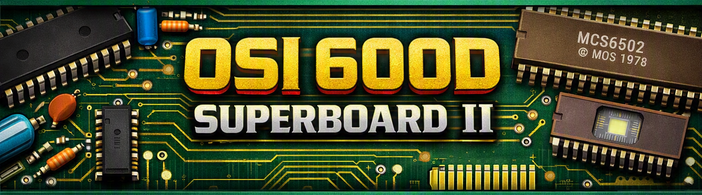

# Ohio Scientific (OSI) 600D Superboard II Recreation

An open-source hardware recreation of the **Ohio Scientific Superboard II, Model 600 revision D**, the classic 6502 single-board computer, as a complete **KiCad 10** project.

The board keeps the original circuit and copper layout, and adds **Cherry MX keyswitches**, ROM sockets for modern **27C16 EPROMs or 2816 EEPROMs**, pin headers for the option jumpers and a fused power input.

As far as we know, this is the first native KiCad PCB and schematic of the 600D, and the only electronic version of its schematic apart from the original scans.

## Project status

- [x] **Gerber import:** layout converted into KiCad 10 from the reproduction Gerber files by Grant (Klyball).
- [x] **Native KiCad board:** imported copper cleaned up into tracks, vias and footprints; via rings, thin tracks and track ends tidied; mounting holes converted to footprints.
- [x] **Schematic:** five hierarchical sheets following the five OSI pages, with logic drawn as gates. The schematic netlist matches the PCB exactly (269 nets).
- [x] **Verification:** every net checked against the OSI 600 rev D schematic (28 Aug 1980, sheets 1–5), and nets named after the original signal names.
- [x] **DRC:** no violations and no unconnected pads, with the default clearance set to 0.15 mm (the original artwork's spacing).
- [x] **Documentation:** schematic and layout booklet, assembly and test guide, interactive BOM.
- [x] **Schematic wiring:** sheets currently connect by net labels; drawing the wires to match the original pages is in progress.
- [x] **3D model:** Cherry MX switch and keycap models for the 3D view.
- [ ] **First build:** prototype boards to be ordered and tested.

## Repository layout

| Folder | Contents |
|---|---|
| `src/` | KiCad 10 project: top-level schematic, the five sheet files and the PCB |
| `documents/` | Schematic and layout booklet (PDF) and the assembly and test guide (Word) |
| `bom/` | Interactive BOM (`ibom.html`) |
| `images/` | Renders and images used in this README |
| `models/` | 3D models for the KiCad 3D viewer |

## The hardware

| | |
|---|---|
| CPU | MOS 6502 at about 1 MHz (3.93216 MHz crystal) |
| RAM | 8 KB on board in 2114 chips (the original shipped with 4 KB fitted) |
| ROM | Monitor (SYN600) at $F800 and 8 KB Microsoft BASIC at $A000–$BFFF |
| Video | Composite monochrome output, 1 KB video RAM, 2716-type character generator; 32/64 character mode select |
| Keyboard | 53 keys plus Break in the original OSI layout, using Cherry MX switches |
| Storage | Cassette interface; RS-232 serial option through the 6850 ACIA |
| Sound | 8-bit DAC output on J4 |
| Expansion | 40-pin J1 for an OSI 610 board; J75 for the colour option |

## What changed from the original board

- **Cherry MX keyboard:** 54 switch positions. The shift lock can be a Cherry MX Lock switch at SW38 (the original position) or a latching switch at SW54; fit only one.
- **ROMs:** the monitor (U13) and BASIC (U9–U12) sockets take 27C16 or 2816 parts. The character generator (U41) is a 2716-type EPROM.
- **Jumpers:** the original wire-jumper blocks are replaced by pin headers W3 and W5.
- **Power:** 5 V enters at the `+5V_IN` holes and passes through fuse F1 before the protection diode D15.
- **Break key (SW40):** snip off the right-hand plastic peg of the switch; that hole was removed because it cut into the ground strip.
- **Do not fit R88.**

### Reference designators changed for KiCad

KiCad needs every reference to be unique and to end in a number, so these parts were renumbered:

| On the OSI sheets | On this board | Part |
|---|---|---|
| R74 (sheet 1) | R88 | 390 Ω DD pull-down, not fitted |
| R62A (sheet 3) | R90 | 100 Ω cassette input resistor |
| R86 (sheet 5) | R89 | 510 Ω sound DAC pull-up (R86 on sheet 3 keeps its number) |
| D3 LED (sheet 5) | LED1 | Power LED |
| R73 470 Ω (sheet 5) | R87 | LED resistor |
| Shift lock | SW54 or SW38 | Latching shift-lock switch |
| Keys | SW1–SW53 | Cherry MX switches; SW40 is Break |

## Building one

Start with the assembly guide in `documents/`. It follows the order of the 1982 OSI kit manual, with every step rewritten for this board:

1. **Stage I:** sockets, diodes, resistors, capacitors and fittings, with continuity tests.
2. **Stage II:** the Cherry MX keyboard.
3. **Stage III:** a power check with no chips, then the video chips and a picture on screen.
4. **Stage IV:** processor, ROMs and RAM, ending with `7423 BYTES FREE`.

Things to know before you order parts:

- **8T28 bus transceivers** (U24, U25, plus U6, U7 and U74 if you fit the options) are obsolete; use new-old-stock parts. The 8T26 is inverting and will not work.
- **ROMs** need 450 ns or faster parts, programmed with the Superboard II / Challenger 1P images. The character generator needs the OSI 600 character set in 2716 layout.
- **Power supply:** a regulated 5 V supply rated at 3 A.

## Documentation

- **Schematic and layout booklet** (`documents/`): cover, foreword, vector traces of the five original OSI sheets with notes on where this board differs, a component placement drawing, and tables of the reference and net-name changes.
- **Assembly and test guide** (`documents/`): step-by-step build with a location figure for every step, keycap placement table, jumper settings, ROM map, troubleshooting chart and bill of materials.
- **Interactive BOM** (`bom/ibom.html`): open it in a browser to find parts on the board while you build.

## Contributing

Help is welcome, especially with:

1. **Schematic wiring:** drawing the wires on the five sheets to match the original pages. The booklet's traced sheets are the reference.
2. **Testing:** building a board and reporting results.
3. **3D models:** Cherry MX switch and keycap models with legends.

Please open an issue or a pull request.

## Credits

- **Ohio Scientific Instruments:** for the original Superboard II and its documentation.
- **Grant (Klyball):** for the reproduction Gerber files this layout is built on.
- **Jon (Bambelweeny57), Submeson Brain Corporation:** KiCad conversion, Cherry MX edition and documentation.

## Licence

This project is shared for educational and preservation purposes. The original Ohio Scientific schematics and manuals remain subject to their original copyrights.
